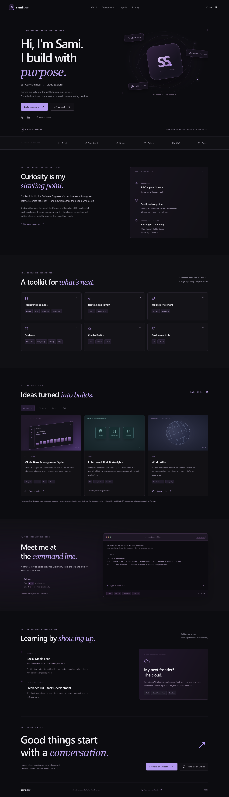
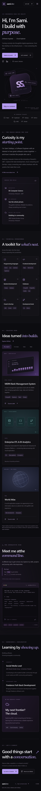

> CURRENT DEPLOYMENT STATUS — October 30, 2026: LIVE on AWS Amplify Hosting.
> URL: https://main.d2p2c6exggp4f1.amplifyapp.com
> App: d2p2c6exggp4f1; branch: main; region: us-east-1; CLI profile: sami-portfolio.
> Browser sign-in succeeded and hosting cost approval was received. Deployment uses the locally tested production ZIP (manual deployment), not GitHub continuous deployment. GitHub repository publishing/connection and AWS Console evidence screenshots remain pending. Earlier authentication blockers and pending-deployment notes below are historical and superseded by this notice.
# Sami's Tech Superpower

A personal portfolio for Sami Siddiqui: software engineering, full-stack development, cloud curiosity and community. Built for the challenge requirements supplied in the project brief; official eligibility and deadlines have not been independently confirmed.

## Features

- Responsive charcoal/violet design with custom CSS monogram and conceptual project illustrations.
- About, six skill groups, project category filters, community experience, learning journey and contact.
- Developer Command Center with real input, history, shortcuts, unknown-command handling, clear and a hidden `superpower` command.
- Semantic sections, keyboard navigation, skip link and reduced motion support.
- No backend, analytics, cookies, secrets or paid runtime dependencies.

## Stack and local setup

React, TypeScript, Vite, Tailwind CSS, Framer Motion, Lucide React. Node 24 recommended.

```powershell
npm ci
npm run dev
```

```powershell
npm run typecheck
npm run lint
npm test
npm run build
npm run preview
```

Production files are generated in `dist/`. Run browser checks with `npx playwright install chromium` then `npm run test:e2e`; these test the production preview and regenerate screenshots.

## Content and repository

Edit `src/data.ts` for skills and projects, `src/commands.ts` for terminal output and `src/App.tsx` for biographical copy. Personal claims come from the brief. Bank and World Atlas repository URLs were verified via the public GitHub API. Live demos were not confirmed and are omitted. The data-engineering repository is empty and is not asserted to contain the ETL project. Email and professional dates were not supplied.

Owner profile: https://github.com/SamiSiddiqui45

Portfolio source: https://github.com/SamiSiddiqui45/samis-tech-superpower

## Screenshots

Browser tests save actual production screenshots in `screenshots/` when successful:




Project graphics are original conceptual illustrations, not screenshots of the showcased applications. AWS console screenshots must be collected after deployment and must never include credentials.

## Deployment

AWS Amplify Hosting is the required target. `amplify.yml` runs clean installation, lint, unit tests and production build, publishing `dist/`. See [AWS_DEPLOYMENT.md](AWS_DEPLOYMENT.md). Live portfolio: https://main.d2p2c6exggp4f1.amplifyapp.com — deployed to AWS Amplify Hosting in us-east-1 using a production ZIP. GitHub continuous deployment is not connected. See [QA_REPORT.md](QA_REPORT.md) and [CHALLENGE_SUBMISSION.md](CHALLENGE_SUBMISSION.md).


